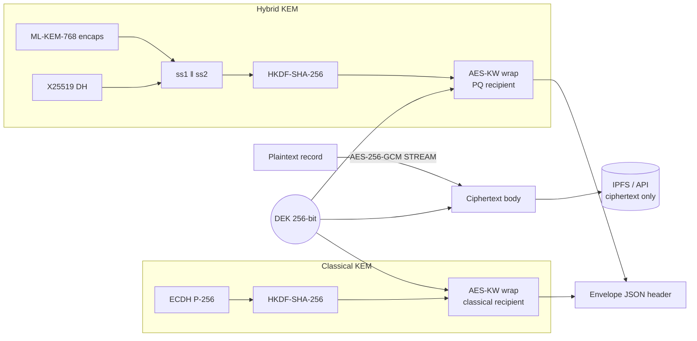
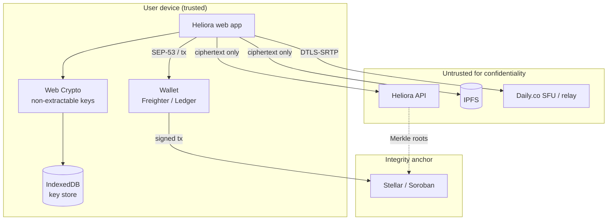

# Cryptographic Specification & Threat Model

> **Status:** living document. It describes what the code in `main` *does*,
> including gaps. Where a primitive is planned but not implemented, this
> document says so explicitly. If you change a primitive, parameter, or
> domain-separation label, update this file in the same PR.
>
> **Audience:** contributors, security reviewers and auditors.
> **Reporting vulnerabilities:** see [`SECURITY.md`](../SECURITY.md); do not open public issues.

## Table of contents

1. [Design principles](#1-design-principles)
2. [Cipher suite inventory](#2-cipher-suite-inventory)
3. [Symmetric encryption: AES-256-GCM](#3-symmetric-encryption-aes-256-gcm)
4. [Key encapsulation: classical and hybrid post-quantum](#4-key-encapsulation-classical-and-hybrid-post-quantum)
5. [Signatures: Ed25519, ML-DSA, RSA-PSS, HMAC](#5-signatures-ed25519-ml-dsa-rsa-pss-hmac)
6. [Hashing and commitments: SHA-256 and Poseidon](#6-hashing-and-commitments-sha-256-and-poseidon)
7. [Key derivation and key storage](#7-key-derivation-and-key-storage)
8. [Zero-knowledge proofs](#8-zero-knowledge-proofs)
9. [Randomness](#9-randomness)
10. [Threat model](#10-threat-model)
11. [Known gaps and roadmap](#11-known-gaps-and-roadmap)
12. [Domain-separation label registry](#12-domain-separation-label-registry)
13. [References](#13-references)

---

## 1. Design principles

1. **Client-side encryption.** Protected health information (PHI) is encrypted in the browser before it reaches the API, IPFS or Stellar. Servers and pinning services store ciphertext only.
2. **Platform primitives first.** All symmetric crypto, ECDH, HKDF, PBKDF2 and RSA use the Web Crypto API (`crypto.subtle`), which runs in native code with constant-time implementations. JavaScript implementations are used only where Web Crypto has no equivalent (ML-KEM, Poseidon, Groth16).
3. **Non-extractable keys at rest.** Long-lived device keys are generated as non-extractable `CryptoKey` objects and persisted in IndexedDB, so page script can use them but never read the key bytes.
4. **Authenticated encryption everywhere.** No unauthenticated cipher modes. Context (owner, slot, sequence number) is bound with AEAD associated data.
5. **Explicit domain separation.** Every KDF and signature message carries a versioned label (see [§12](#12-domain-separation-label-registry)).
6. **Hybrid post-quantum where it matters.** Long-lived confidentiality (medical record envelopes) can be protected with a hybrid ML-KEM-768 + X25519 KEM. Breaking it requires breaking *both*, which protects against "harvest-now, decrypt-later" adversaries.
7. **Fail closed.** Decryption, KDF-parameter or signature failures throw. They never fall back to plaintext.

---

## 2. Cipher suite inventory

| Purpose | Primitive | Parameters | Implementation | Status |
|---|---|---|---|---|
| Record & file encryption | **AES-256-GCM** | 256-bit key, 96-bit IV, 128-bit tag | Web Crypto (`src/lib/crypto.ts`, `crypto.worker.ts`) | ✅ Production |
| Streaming envelope (large files) | AES-256-GCM STREAM | 64 KiB chunks, IV = prefix‖index‖last | `src/lib/crypto.ts` | ✅ Production |
| DEK wrap per recipient (classical) | ECDH **P-256** → **HKDF-SHA-256** → **AES-KW** | RFC 3394 key wrap, 256-bit KEK | `src/lib/crypto.ts` | ✅ Production |
| DEK wrap per recipient (PQ hybrid) | **ML-KEM-768** + **X25519** → HKDF-SHA-256 → AES-KW | FIPS 203, RFC 7748, SP 800-227 combiner | `src/lib/pqcHybridKem.ts`, `crypto.ts` | 🟡 Feature-flagged (`NEXT_PUBLIC_PQC_ENABLED`) |
| Teleconsultation chat E2EE | ECDH P-256 → HKDF-SHA-256 → AES-256-GCM | Per-tab ephemeral keys, AAD = `session:seq` | `src/lib/cryptoChat.ts` | ✅ Production |
| Local encrypted slots | AES-256-GCM | Non-extractable IndexedDB key, AAD = `namespace:owner` | `encryptedLocalStore.ts`, `offlineRecordCache.ts`, `clinicalOutbox.ts` | ✅ Production |
| Recovery backup | PBKDF2-HMAC-SHA-256 → AES-256-GCM | 600 000 iterations (min), 32-byte salt | `src/lib/crypto.ts` | ✅ Production |
| Social recovery | Shamir (k, n) over GF(256) | Byte-wise split | `src/lib/shamir.ts` | ✅ Primitive only |
| Wallet / transaction signatures | **Ed25519** | Stellar keypairs, SEP-10, SEP-53 | `@stellar/stellar-sdk`, Freighter, Ledger | ✅ Production |
| Credential attestation | Ed25519 | Issuer Stellar key | `clinicianCredentialAttestation.ts` | ✅ Production |
| Post-quantum signatures | **ML-DSA** (Dilithium) | FIPS 204 | `src/lib/pdfSignature.ts` | 🔴 **Placeholder, not secure** (see [§11](#11-known-gaps-and-roadmap)) |
| Anonymous trial enrollment | RSA blind signatures (Chaum) | RSA-PSS 2048-bit key, e = 65537, SHA-256 | `src/lib/blindSignature.ts` | ✅ Production |
| Role tokens | HMAC-SHA-256 | Server-held key | `src/lib/roleTokenSigning.ts` | ✅ Production |
| Content hashes, Merkle audit | **SHA-256** | RFC 6962 leaf/node prefixes | `crypto.ts`, `merkleAudit.ts` | ✅ Production |
| ZK commitments | **Poseidon** (BN254) | circomlib parameters | `circuits/*.circom`, `circomlibjs` | ✅ Production |
| ZK in-circuit signatures | EdDSA-Poseidon on Baby Jubjub | circomlib `EdDSAPoseidonVerifier` | `circuits/clinician_credential.circom` | ✅ Production |
| ZK proofs | Groth16 over BN254 | Soroban native BN254 pairing | `zkEligibility.ts`, `contracts/zk-verifier` | ✅ Production (trusted setup caveats in [`zk-circuits.md`](./zk-circuits.md)) |

---

## 3. Symmetric encryption: AES-256-GCM

### 3.1 Single-shot file encryption (`encryptFile`)

- A fresh 256-bit key is generated **per file** with `crypto.subtle.generateKey`.
- A fresh 96-bit IV comes from `crypto.getRandomValues`.
- Because each key encrypts exactly one message, (key, IV) reuse is impossible by construction.
- `hashBuffer` computes SHA-256 over the **ciphertext**. It serves as a content address and dedup key, not as an integrity check (GCM's tag provides integrity).

### 3.2 Streaming envelope (`encryptFileToEnvelope`)

Large files (≤ 250 MB) are encrypted as a STREAM construction (Hoang–Reyhanitabar–Rogaway–Vizár, as used by Tink's streaming AEAD):

```
IV(i) = noncePrefix (7 bytes, random per file) ‖ uint32_be(i) ‖ lastFlag (1 byte)
C_i   = AES-256-GCM(DEK, IV(i), P_i)          for 64 KiB plaintext chunks P_i
```

- Sequential indices guarantee unique IVs under one DEK (2³² chunks × 64 KiB ≫ 250 MB).
- The last-chunk flag makes **truncation, reordering and extension** fail authentication.
- Container: `"HLE1" ‖ u32 headerLen ‖ JSON header ‖ body`. Recipients can be added or removed by rewriting only the header; the body never changes.

### 3.3 Associated data (AAD) bindings

| Context | AAD | Prevents |
|---|---|---|
| Chat message | `"${sessionId}:${sequence}"` | Cross-session replay, message reordering |
| Encrypted local slot | `namespace:owner` | Swapping ciphertext between wallets/slots on a shared device |
| Offline record cache | patient Stellar address | Cross-wallet decryption of cached records |
| Clinical outbox | owner ‖ item id | Moving queued writes between users |

---

## 4. Key encapsulation: classical and hybrid post-quantum

### 4.1 Classical envelope KEM (default)

Each recipient holds a long-term **P-256** ECDH key pair, generated non-extractable and stored in IndexedDB (`envelopeKeys.ts`). To share a file's DEK:

```
(esk, epk)  ← P-256 ephemeral key pair
Z           ← ECDH(esk, recipientPub)
KEK         ← HKDF-SHA-256(Z, info = "heliora/envelope/v1/ecdh-p256-hkdf-sha256-a256kw")
wrappedKey  ← AES-KW(KEK, DEK)                     (RFC 3394, 40 bytes)
recipient   = { id, epk, wrappedKey }
```

AES-KW's built-in integrity check makes unwrapping with the wrong key fail with `OperationError`.

### 4.2 Hybrid KEM: ML-KEM-768 + X25519

Implemented in `src/lib/pqcHybridKem.ts` per **NIST SP 800-227 §5** (multi-algorithm KEMs). It is gated behind `NEXT_PUBLIC_PQC_ENABLED=true`: when the flag is off, every export throws.

| Component | Standard | Public key | Ciphertext | Shared secret |
|---|---|---|---|---|
| ML-KEM-768 | FIPS 203 (`mlkem` npm) | 1184 B | 1088 B | 32 B |
| X25519 | RFC 7748 (Web Crypto) | 32 B | 32 B (ephemeral pub) | 32 B |
| **Hybrid** | SP 800-227 | 1216 B | **1120 B** | **32 B** |

**Combiner.**

```
ikm  = ss_mlkem ‖ ss_x25519
ss   = HKDF-SHA-256(ikm, salt = 0³², info = "heliora/pqc-hybrid/v1/mlkem768-x25519", L = 32)
```

The output is pseudorandom as long as **either** input secret is, so a future quantum break of X25519 or a cryptanalytic break of ML-KEM alone does not reveal the DEK.

#### Encapsulation and decapsulation flow

```mermaid
sequenceDiagram
    autonumber
    participant S as Sender (browser)
    participant R as Recipient (browser)
    participant API as Heliora API / IPFS

    R->>R: (ek, dk) ← ML-KEM-768.KeyGen()
    R->>R: (xpk, xsk) ← X25519.KeyGen()
    R->>API: publish hybrid public key {ek, xpk}
    S->>API: fetch {ek, xpk}
    S->>S: (ct_mlkem, ss1) ← ML-KEM.Encaps(ek)
    S->>S: (epk, esk) ← X25519.KeyGen(); ss2 ← DH(esk, xpk)
    S->>S: KEK ← HKDF-SHA-256(ss1 ‖ ss2, info)
    S->>S: wrapped ← AES-KW(KEK, DEK)
    S->>API: envelope header += {ct_mlkem, epk, wrapped}
    R->>API: fetch envelope
    R->>R: ss1 ← ML-KEM.Decaps(dk, ct_mlkem); ss2 ← DH(xsk, epk)
    R->>R: KEK ← HKDF-SHA-256(ss1 ‖ ss2, info)
    R->>R: DEK ← AES-KW-Unwrap(KEK, wrapped)
    R->>R: plaintext ← AES-256-GCM STREAM decrypt(DEK, body)
```

#### Where the hybrid KEM sits in the envelope



### 4.3 Chat key agreement

`cryptoChat.ts`: each browser tab creates a fresh P-256 ECDH key pair per appointment, and public keys are exchanged over the room WebSocket. The session key is:

```
salt = SHA-256(sessionId)
info = "heliora/teleconsultation-chat/v1" ‖ sort(localPub, peerPub)
key  = HKDF-SHA-256(ECDH(sk, peerPub), salt, info) → AES-256-GCM (non-extractable)
```

Sorting the public keys gives both parties the same `info` and binds the key to this exact pair. Ephemeral keys provide **forward secrecy** at session granularity. The relay sees only public keys and ciphertext. Peer public keys are not yet authenticated; see T-6 in [§10](#10-threat-model).

---

## 5. Signatures: Ed25519, ML-DSA, RSA-PSS, HMAC

### 5.1 Ed25519 (Stellar)

All user identity is a Stellar account, i.e. an **Ed25519** key held in Freighter, a Ledger device (`ledgerHardwareWallet.ts`) or another SEP-7 wallet. Heliora never sees the secret key. Ed25519 is used for:

- **Transactions** (Soroban contract calls, payments), signed by the wallet and verified by the network.
- **SEP-10** web authentication: the client validates the challenge (sequence 0, server signature, time bounds, `web_auth_domain`) before signing.
- **SEP-53** message signing: anti-phishing shield registration, address-book backup key derivation, delegated proxy co-signatures.
- **Credential attestation**: issuers sign clinician credentials, and `verifyCredentialSignature` checks them with `Keypair.verify`.

Ed25519 signatures are deterministic (RFC 8032), and `addressBook.ts` relies on this to re-derive a stable backup key from `HKDF(SEP-53 signature of a fixed message)`. **That message must never change** or existing backups become unreadable.

### 5.2 ML-DSA (Dilithium): planned, not implemented

`src/lib/pdfSignature.ts` exposes `generateDilithiumKeyPair`, `signDilithium` and `verifyDilithium` for prescription and PDF signing. **They are placeholders:** keys are zero-filled, signatures are zero-filled, and `verifyDilithium` returns `true` for any signature of 666 bytes or more. The functions throw unless `NEXT_PUBLIC_PQC_ENABLED=true`.

> ⚠️ **Do not enable `NEXT_PUBLIC_PQC_ENABLED` in production** until ML-DSA is backed by a FIPS 204 implementation (e.g. `@noble/post-quantum` `ml_dsa65`). The same flag enables the hybrid KEM, so the two must be split or ML-DSA finished first. Tracked in [§11](#11-known-gaps-and-roadmap).

Target parameters: **ML-DSA-65** (NIST category 3, matching ML-KEM-768): 1952-byte public key, 3309-byte signature.

### 5.3 RSA blind signatures

`blindSignature.ts` implements Chaum's textbook RSA blind signature for anonymous clinical-trial enrollment. The hospital signer's key is RSA 2048-bit, e = 65537, generated via Web Crypto (`RSA-PSS`/SHA-256) and used with raw modular arithmetic (BigInt).

- This is **not** RFC 9474 RSABSSA. Messages are hashed (SHA-256) before blinding, which prevents the trivial multiplicative forgery on raw messages, but the scheme lacks PSS-style randomised encoding.
- Blinding factors `r` come from `crypto.getRandomValues`, reduced mod `n` (`r = 0` is mapped to 1). There is no explicit `gcd(r, n) = 1` check; for a 2048-bit RSA modulus a non-invertible `r` has negligible probability, but the check is listed in [§11](#11-known-gaps-and-roadmap).

### 5.4 HMAC-SHA-256 role tokens

`roleTokenSigning.ts` signs role tokens (address, role, expiry) with HMAC-SHA-256 under a **server-held** key, and checks them against an in-memory revocation list. The key must never be shipped to the browser. Client-side code only verifies structure and expiry.

---

## 6. Hashing and commitments: SHA-256 and Poseidon

### 6.1 SHA-256

| Use | Construction |
|---|---|
| Ciphertext content address | `SHA-256(ciphertext)` hex |
| Merkle audit tree | RFC 6962: leaf `H(0x00 ‖ entry)`, node `H(0x01 ‖ L ‖ R)`; daily roots anchored to a Stellar ledger close hash |
| Chat salt | `SHA-256(sessionId)` |
| Co-signature payload | SEP-53 over `SHA-256(draft)` ‖ ids ‖ addresses ‖ time |
| Viewer watermark fingerprint | `SHA-256(viewerPublicKey : viewerIpHash : viewedAt)` |

### 6.2 Poseidon

Poseidon is a SNARK-friendly hash over the **BN254 scalar field** (`p = 21888…5617`). It costs roughly 250 constraints per hash, against roughly 25 000 for SHA-256 in-circuit. Heliora uses circomlib's parameters (x⁵ S-box, 8 full rounds, width-dependent partial rounds) via `circomlib/circuits/poseidon.circom` in-circuit and `circomlibjs` off-circuit.

| Commitment | Formula | Circuit |
|---|---|---|
| Age | `Poseidon(birthDate, salt)` | `age_eligibility` |
| Insurance | `Poseidon(policyId, expiryDate, salt)` | `insurance_coverage` |
| Residency | `Poseidon(zipCode, salt)`, Merkle path over `Poseidon(zipCode)` leaves | `geo_residency` |
| Financial hardship | `Poseidon(householdIncome, householdSize, salt)` | `financial_hardship` |

- **Salts** are supplied by the credential issuer (`zkEligibility.ts` credential types) and must be ≥ 128-bit random field elements. Without one, a commitment to a low-entropy value such as a birth date could be brute-forced.
- `zkInputValidation.ts` rejects any input ≥ the BN254 scalar modulus. Without that check, a value and the same value + p would alias to one field element.

---

## 7. Key derivation and key storage

| Key | Derivation | Storage | Extractable |
|---|---|---|---|
| File DEK | random 256-bit | wrapped in envelope header | yes (needed for re-wrap), never exported unwrapped |
| Envelope recipient key | P-256 random | IndexedDB `heliora-envelope-keys` | **no** |
| Local slot key | AES-256 random per namespace | IndexedDB | **no** |
| Chat session key | ECDH → HKDF | memory only | **no** |
| Recovery backup key | **PBKDF2-HMAC-SHA-256**, 600 000 iterations, 32-byte salt, NFKD passphrase | derived on demand | **no** |
| Address-book backup key | HKDF-SHA-256(SEP-53 signature) | derived on demand | no |
| SEP-10 JWT | issued by anchor | memory only (bearer credential, never persisted) | n/a |

**PBKDF2 parameter validation.** On restore, `restoreRecoveryKey` rejects backups whose iteration count is below 600 000 (downgrade attack) or above 10 000 000 (CPU-exhaustion DoS from a crafted backup file).

**Zeroization.** `zeroMemory.ts` overwrites sensitive `ArrayBuffer`s with random bytes and then zeros after use. This is best-effort: JS engines may already have copied the data.

---

## 8. Zero-knowledge proofs

Groth16 over BN254, with circuits written in Circom 2.1.6, proved in a Web Worker with snarkjs and verified on-chain by the `zk-verifier` Soroban contract using Stellar's native BN254 pairing host functions. Circuit details, constraint budgets and the trusted-setup ceremony are in [`zk-circuits.md`](./zk-circuits.md).

Security notes:

- Groth16 soundness depends on at least one honest participant in the phase-2 setup. The verifying key hash is pinned in the contract.
- Proofs are **malleable** (an observer can re-randomise a valid proof). Nullifiers and replay protection must bind to public inputs, not to proof bytes.
- Witness generation runs entirely client-side, so private inputs never leave the device.

---

## 9. Randomness

- All key material, IVs, salts and blinding factors use `crypto.getRandomValues` or `crypto.subtle.generateKey`.
- `Math.random` is banned in crypto modules by convention (documented at the top of `encryptedLocalStore.ts`).
- `auditEntropySource` in `crypto.ts` runs a lightweight health check (rejects long runs of identical bytes) and `checkSecurityContext` warns via Sentry when executing in a non-HTTPS context or inside an iframe, where `crypto.subtle` may be unavailable or the context untrusted.

---

## 10. Threat model

### 10.1 Assets

| Asset | Confidentiality | Integrity | Availability |
|---|---|---|---|
| Medical records (PHI) | **Critical** | **Critical** | High |
| Teleconsultation audio/video/chat | **Critical** | High | High |
| Wallet secret keys | **Critical** | **Critical** | High |
| Access grants & audit log | Medium | **Critical** | High |
| ZK private inputs (DOB, income…) | High | High | Medium |
| Recovery passphrase / shares | **Critical** | High | High |

### 10.2 Adversaries

| ID | Adversary | Capabilities |
|---|---|---|
| A1 | Network attacker | Observes/modifies traffic; TLS assumed intact except for A6 |
| A2 | Honest-but-curious server / IPFS pinning service | Reads everything stored or relayed |
| A3 | Compromised backend | Serves malicious keys, ciphertexts or API responses |
| A4 | Malicious co-user / other patient | Valid account, attempts to access others' data |
| A5 | Local attacker | Disk or shared-device access, no live session |
| A6 | Future quantum adversary | Harvest-now, decrypt-later against recorded ciphertext |
| A7 | Phishing site | Look-alike origin that tries to collect signatures or passphrases |
| A8 | Supply-chain attacker | Compromised npm dependency or CDN |

### 10.3 Threats and mitigations (STRIDE)

| # | Threat | Adversary | Mitigation | Residual risk |
|---|---|---|---|---|
| T-1 | Server reads PHI | A2 | Client-side AES-256-GCM; DEK only wrapped to recipient keys | Metadata (sizes, timing, who-shares-with-whom) visible |
| T-2 | Ciphertext tampering / truncation | A1, A3 | GCM tag; STREAM last-chunk flag; AES-KW integrity | — |
| T-3 | Cross-user ciphertext swap | A4, A5 | AAD binds owner / slot / patient address | — |
| T-4 | Harvest-now, decrypt-later | A6 | Hybrid ML-KEM-768 + X25519 envelope recipients | Feature-flagged; classical recipients remain vulnerable to A6 |
| T-5 | Malicious recipient key substitution | A3 | Recipient IDs are Stellar addresses; access grants are on-chain | **Gap:** recipient P-256 keys are not yet signed by the owner's Ed25519 key |
| T-6 | Chat MITM via key substitution | A3 | E2EE via ECDH; relay sees ciphertext only | **Gap:** no out-of-band key fingerprint verification or SEP-53 binding of chat keys |
| T-7 | Key exfiltration via XSS | A1, A8 | Non-extractable `CryptoKey`s; strict nonce CSP with `strict-dynamic`; DOMPurify; SVG/file sanitisers | XSS can still *use* keys during a session |
| T-8 | Phishing for signatures | A7 | Anti-phishing shield (origin-scoped secret); SEP-10 `web_auth_domain` check; frame-busting + `frame-ancestors 'none'` | User may ignore missing shield |
| T-9 | Recovery backup brute force | A5 | PBKDF2 600k iterations; BIP-39 entropy; Shamir split across guardians | Weak user passphrase |
| T-10 | KDF downgrade / DoS via crafted backup | A3, A5 | Iteration bounds [600k, 10M] enforced on restore | — |
| T-11 | ZK witness leakage / forged proofs | A2, A4 | Client-side proving; Poseidon salted commitments; field-range validation; on-chain verifier | Groth16 trusted setup assumption |
| T-12 | Replay of chat or role tokens | A1, A4 | Sequence numbers in AAD; token expiry + revocation list | In-memory revocation list resets on restart |
| T-13 | Audit log rewriting | A3 | RFC 6962 Merkle tree anchored to Stellar ledger close hash | Anchoring is daily |
| T-14 | Forged PQ prescription signatures | A3, A4 | **None yet**: ML-DSA is a placeholder | **Critical if the PQC flag is enabled** (see §5.2) |
| T-15 | Teleconsultation media interception | A1, A2 | DTLS-SRTP (WebRTC mandatory); short-lived Daily meeting tokens; on-device background segmentation (no frames uploaded) | SFU sees decrypted media (no insertable-streams E2EE yet) |
| T-16 | Malicious dependency | A8 | Lockfile; heavy crypto via Web Crypto rather than JS deps; MediaPipe assets self-hosted | npm compromise of `mlkem`, `snarkjs`, `circomlibjs` |

### 10.4 Trust boundaries



---

## 11. Known gaps and roadmap

| Gap | Impact | Suggested fix |
|---|---|---|
| ML-DSA is a placeholder; `verifyDilithium` accepts any ≥ 666-byte signature | Forged PQ signatures if `NEXT_PUBLIC_PQC_ENABLED=true` | Implement with a FIPS 204 library (ML-DSA-65); split the feature flag from the KEM |
| `signPrescriptionMetadata` in `pqcHybridKem.ts` does not `await` `crypto.subtle.digest` | Hash comparison is over Promises, so it is broken | Make it async and await the digest |
| Recipient ECDH keys are not authenticated | Backend could substitute keys (T-5) | Sign recipient public keys with SEP-53 and verify before wrapping |
| Chat keys are not authenticated (T-6) | MITM by a malicious relay | Display a short authentication string or bind keys with SEP-53 |
| No media E2EE beyond DTLS-SRTP | SFU sees decrypted media | WebRTC Encoded Transforms (SFrame) |
| Blind signatures are textbook RSA, no `gcd(r, n)` check | Weaker than RFC 9474 | Migrate to RSABSSA-SHA384-PSS-Randomized |
| Role-token revocation list is in memory | Revocations lost on restart | Persist server-side |

---

## 12. Domain-separation label registry

Changing any label below breaks compatibility with existing ciphertext or derived keys and **requires a version bump and migration path**.

| Label | Used in |
|---|---|
| `heliora/envelope/v1/ecdh-p256-hkdf-sha256-a256kw` | Envelope KEM HKDF info (`crypto.ts`) |
| `heliora/pqc-hybrid/v1/mlkem768-x25519` | Hybrid KEM combiner HKDF info (`pqcHybridKem.ts`) |
| `heliora/teleconsultation-chat/v1` | Chat HKDF info prefix (`cryptoChat.ts`) |
| `HLE1` | Envelope container magic |
| SEP-53 address-book backup message | `addressBook.ts`: must never change |
| SEP-53 anti-phishing registration / attestation messages | `antiPhishing.ts` |

---

## 13. References

- NIST FIPS 197 (AES), SP 800-38D (GCM), RFC 3394 (AES Key Wrap)
- NIST FIPS 203 (ML-KEM), FIPS 204 (ML-DSA), SP 800-227 (Recommendations for KEMs)
- RFC 7748 (X25519), RFC 8032 (Ed25519), RFC 5869 (HKDF), RFC 8018 (PBKDF2)
- RFC 6962 (Certificate Transparency Merkle trees), RFC 9474 (RSA Blind Signatures)
- Hoang, Reyhanitabar, Rogaway, Vizár: *Online Authenticated-Encryption and its Nonce-Reuse Misuse-Resistance* (STREAM), CRYPTO 2015
- Grassi et al.: *Poseidon: A New Hash Function for Zero-Knowledge Proof Systems*, USENIX Security 2021
- Groth: *On the Size of Pairing-based Non-interactive Arguments*, EUROCRYPT 2016
- Stellar SEP-10, SEP-53; OWASP Password Storage Cheat Sheet
