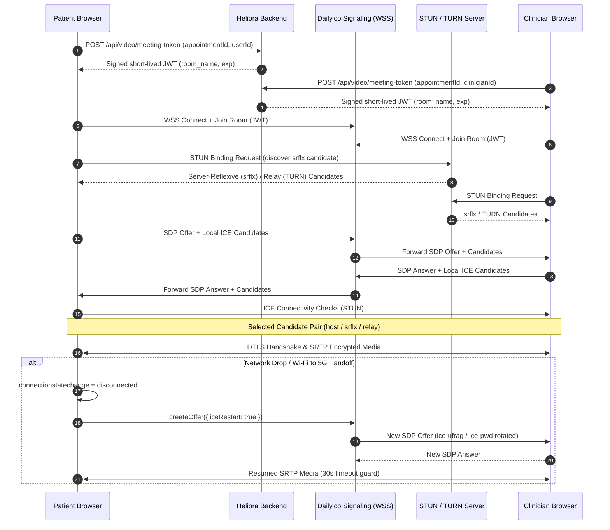
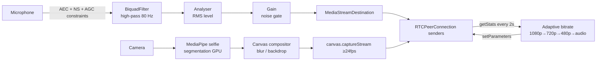

# Telemedicine WebRTC & Media Architecture Guide

This document describes Heliora's client-side telemedicine media pipeline, signaling and ICE negotiation flow, dual-consent transcription architecture, network firewall requirements, and troubleshooting procedures.

---

## 1. Architecture Overview

Heliora conducts real-time video consultations over WebRTC using Daily.co rooms (`src/lib/video.ts`) paired with:

- **Short-lived meeting tokens** signed by the backend (`fetchMeetingToken`), scoped to `appt-<appointmentId>` and expiring at appointment end (`scheduleTokenExpiry`).
- **Adaptive bitrate & quality tiering** (`selectQualityTier`, `startQualityTiering`) that dynamically steps between `high` (720p30), `medium` (480p24), `low` (240p15), and `audio-only` based on outbound RTP throughput.
- **Automatic ICE restart & reconnection** (`createReconnectionController` in `src/lib/video.ts` and `ReconnectionOverlay` in `src/components/consultation/ReconnectionOverlay.tsx`) with a 30-second countdown on network drops.
- **Client-side background blur** (`src/lib/videoBackgroundBlur.ts`) and **dual-consent live transcription** (`src/lib/transcription.ts`).

---

## 2. Signaling & ICE Negotiation Sequence

---

## 3. Dual-Consent Transcription Architecture

Heliora's clinical transcription (`src/lib/transcription.ts`) operates **entirely in-browser** using the Web Speech API (`SpeechRecognition` / `webkitSpeechRecognition`) and enforces explicit **dual-party consent** before any speech is captured or summarized:

1. **Consent State Machine (`TranscriptionConsentState`)**:
   - Both `patientConsent` and `clinicianConsent` default to `false`.
   - Consent toggles are synchronized over the consultation session's encrypted signaling/data channel.
   - Speech recognition **cannot start** until `patientConsent && clinicianConsent === true`.
2. **Revocation**:
   - Either participant may revoke consent at any time during the call.
   - Revocation immediately invokes `recognition.abort()` / `recognition.stop()`, halting audio capture.
3. **Zero Server Audio Upload**:
   - Raw consultation audio never leaves the browser to a Heliora transcription server.
   - Interim and final `TranscriptSegment` items remain in client memory and are used locally to draft a structured SOAP note (`ClinicalDraftNote`).
4. **Telemetry & PII Scrubbing**:
   - Any error or quality telemetry sent to Sentry (`src/lib/sentry.ts`) strips `transcript`, `dictation`, `notes`, and `patientName` fields via `scrubData`.

---

## 4. Network & Firewall Requirements

To ensure reliable WebRTC media establishment behind corporate, hospital, or strict NAT firewalls, allow the following outbound traffic:

| Protocol | Port(s) | Purpose | Required / Fallback |
| --- | --- | --- | --- |
| **TCP** | `443` | HTTPS API calls, WSS signaling, and **TURN over TLS** (`turns:`) | **Required** |
| **UDP** | `3478` | STUN binding & TURN media relay | **Recommended** (falls back to TCP 443) |
| **TCP** | `3478` | TURN over TCP when UDP is blocked | Fallback |
| **UDP** | `1024–65535` (or `40000–49999`) | Ephemeral peer-to-peer / SFU SRTP media | **Recommended** for lowest latency |

### Domain Allowlist

- `*.daily.co` (HTTPS/WSS signaling and SFU media)
- `*.turn.daily.co` / configured `NEXT_PUBLIC_DAILY_DOMAIN` (TURN/STUN relays)
- Heliora API origin (`NEXT_PUBLIC_API_URL`) for `/api/video/meeting-token`

### Bandwidth Guidelines

- **High (720p @ 30fps):** >= 1000 kbps
- **Medium (480p @ 24fps):** 500–999 kbps
- **Low (240p @ 15fps):** 300–499 kbps
- **Audio-only:** < 300 kbps

---

## 5. WebRTC Troubleshooting Guide

| Symptom | Likely Cause | Diagnostic Check | Resolution |
| --- | --- | --- | --- |
| **ICE stuck in `checking` or `failed`** | Symmetric NAT or blocked UDP `3478` / `443` | Inspect `chrome://webrtc-internals` for `candidate-pair` state and `relay` candidates | Verify TCP `443` (`turns:`) is not intercepted by SSL inspection proxies |
| **One-way audio or black video** | Missing media permissions or asymmetric firewall | Check `navigator.mediaDevices.getUserMedia` errors and `inbound-rtp` bytesReceived | Re-grant browser camera/mic permissions; verify UDP media ports or TURN relay |
| **Choppy audio / frozen video** | High RTT, jitter, or packet loss (> 5%) | Review WebRTC `getStats()` (`jitter`, `roundTripTime`, `packetsLost`, `framesDropped`) | `startQualityTiering` automatically steps down to `low` or `audio-only`; move closer to router |
| **Frequent 30s reconnection overlays** | Wi-Fi/cellular handoff or VPN tunnel drops | Watch `online`/`offline` events and `iceconnectionstatechange` | Disable split-tunnel VPNs; `createReconnectionController` triggers automatic ICE restart |
| **Call disconnects abruptly** | Short-lived meeting token expired | Check `videoRoomExpiresAt` and `scheduleTokenExpiry` | Refresh appointment room token via `fetchMeetingToken` |
| **Remote hears hum, fan or keyboard noise** | Noise cancellation off, or the browser ignored AEC/NS constraints | `enforceAudioTrackConstraints(track)` resolves `false` | Turn **Noise cancel** on in the toolbar; use Chrome/Edge/Firefox/Safari 16.4+ |
| **"Background effects could not start"** | MediaPipe assets missing or WebAssembly blocked | Network tab: `/mediapipe/wasm/*` and `/mediapipe/selfie_segmenter.tflite` return 200 | Run `npm run mediapipe:assets` before `build`; CSP must include `'wasm-unsafe-eval'` |

---

## 6. In-Call Media Processing

Three client-side stages run between the camera/microphone and the peer connection. All of them run on the device, and no audio or video is sent anywhere for processing. `useConsultationMedia` wires them up when `ConsultationView` receives `localStream` / `peerConnection`, and swaps the processed tracks onto the senders with `RTCRtpSender.replaceTrack` (no renegotiation).

### 6.1 Adaptive bitrate & bandwidth estimation (#254)

`startAdaptiveBitrate(pc)` in `src/lib/video.ts`:

- Polls `getStats()` every **2 s** and computes packet loss over the **interval** (counter deltas) for both directions, using `outbound-rtp` + `remote-inbound-rtp` for send and `inbound-rtp` for receive. The worse direction wins.
- Reads the sender-side bandwidth estimate from the nominated `candidate-pair.availableOutgoingBitrate`.
- **Step-down:** loss > 5% moves one rung down `1080p → 720p → 480p → audio-only`.
- **Step-up:** five consecutive polls (10 s) under 2% loss move one rung up. Polls between 2% and 5% hold the rung and reset the streak (hysteresis).
- Rungs are applied with `RTCRtpSender.setParameters` (`scaleResolutionDownBy`, `maxBitrate`, `maxFramerate`). For audio-only the video encoding is set to `active: false`, so recovery is instant.
- The toolbar **connection quality pill** shows Excellent / Good / Fair / Poor (from loss and RTT), plus the current rung.

| Rung | Height | Max bitrate | Max fps |
|---|---|---|---|
| 1080p | 1080 | 2.5 Mbps | 30 |
| 720p | 720 | 1.2 Mbps | 30 |
| 480p | 480 | 600 kbps | 24 |
| audio-only | — | video off | — |

### 6.2 Background blur & clinical backdrops (#255)

`BackgroundEffectProcessor` in `src/lib/videoBackgroundBlur.ts`, configured from the **Video settings** modal:

- **Segmentation:** MediaPipe Tasks Vision `ImageSegmenter` with the selfie model in VIDEO mode, on the GPU (WebGL2) delegate with CPU fallback. Assets are **self-hosted** under `public/mediapipe/`; run `npm run mediapipe:assets`.
- **Options:** Off, Blur · Light (6 px), Blur · Strong (16 px), and three procedural clinical backdrops (Clinic neutral, Consult room, Calm blue).
- **≥ 24 fps:** frames are scheduled with `requestVideoFrameCallback`, and output is `canvas.captureStream(max(24, target))`. If segmentation takes more than 80% of the frame budget, the mask is reused for 2–3 frames while compositing continues every frame.
- **Fail-safe UX:** if the model cannot load, video passes through untouched and the modal warns that the real background is visible.
- The model is only downloaded once the user picks an effect.

### 6.3 Noise cancellation & echo suppression (#256)

- `getEnhancedAudioConstraints()` forces `echoCancellation`, `noiseSuppression` and `autoGainControl` on. They are used by every quality tier and re-applied to existing tracks with `enforceAudioTrackConstraints`.
- `createNoiseCancellationPipeline(stream)` builds `source → high-pass (80 Hz, Butterworth Q) → analyser → gain (noise gate) → destination`.
- The noise gate opens at −50 dBFS, closes below −56 dBFS (hysteresis), holds for 200 ms, and attacks in 5 ms / releases in 80 ms to a 0.05 floor gain so silence sounds natural.
- **Noise cancel on/off** in the toolbar bypasses the filter and gate without rebuilding the graph.
